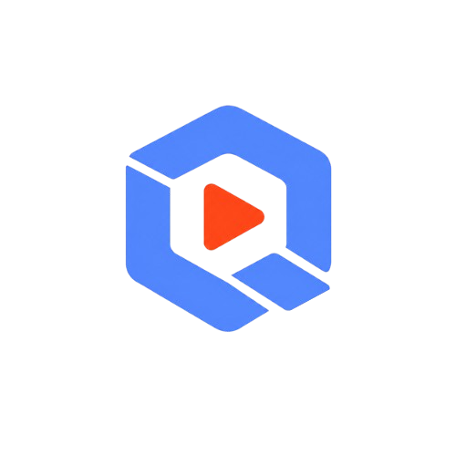
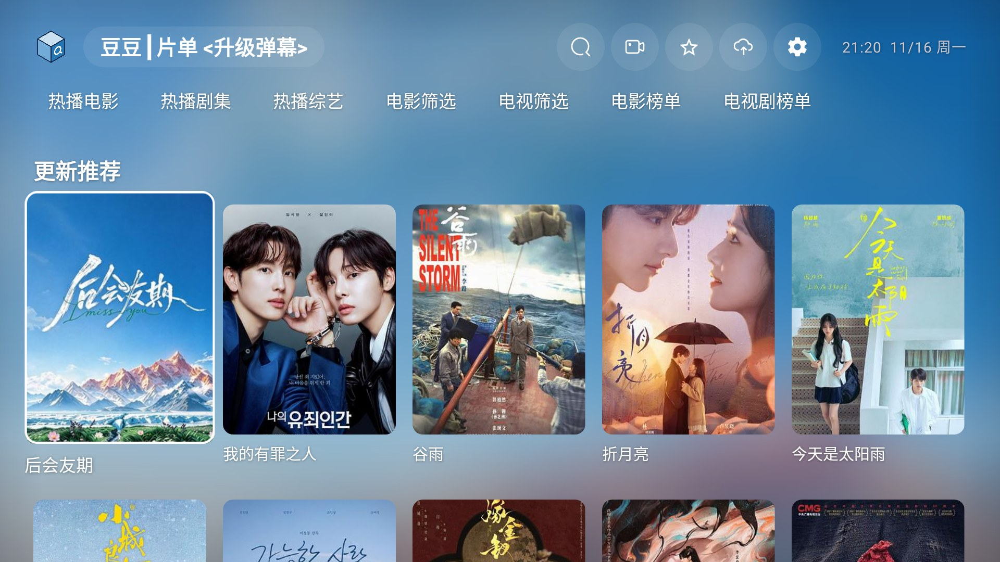
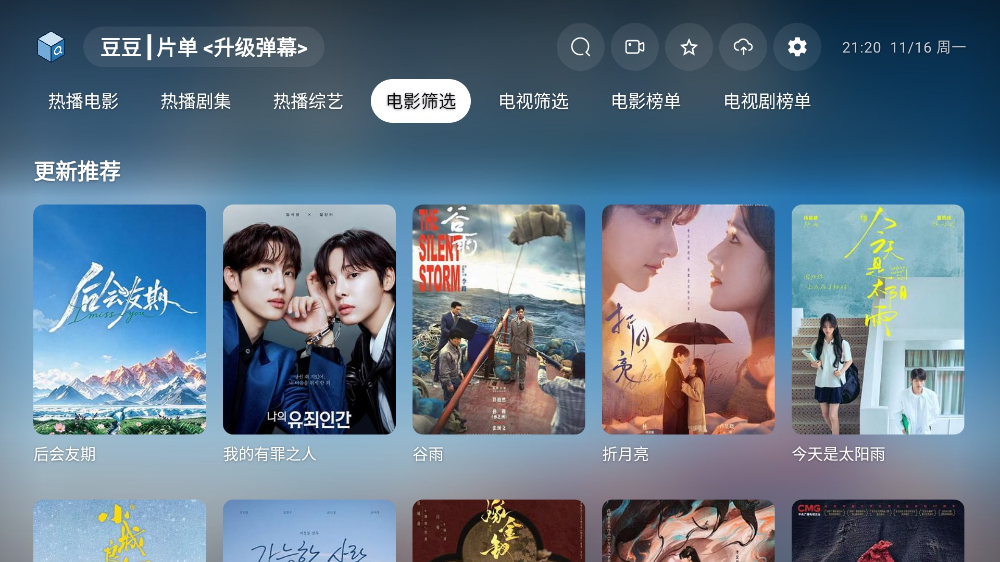
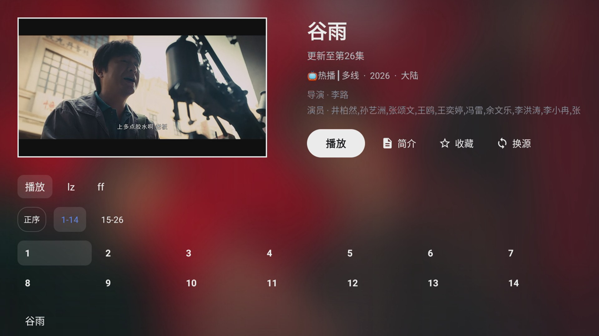
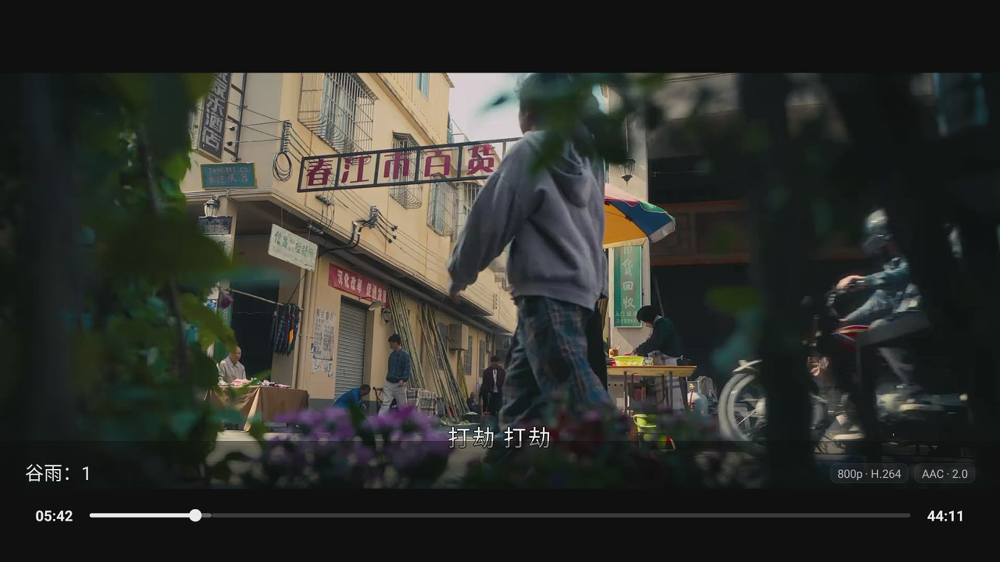
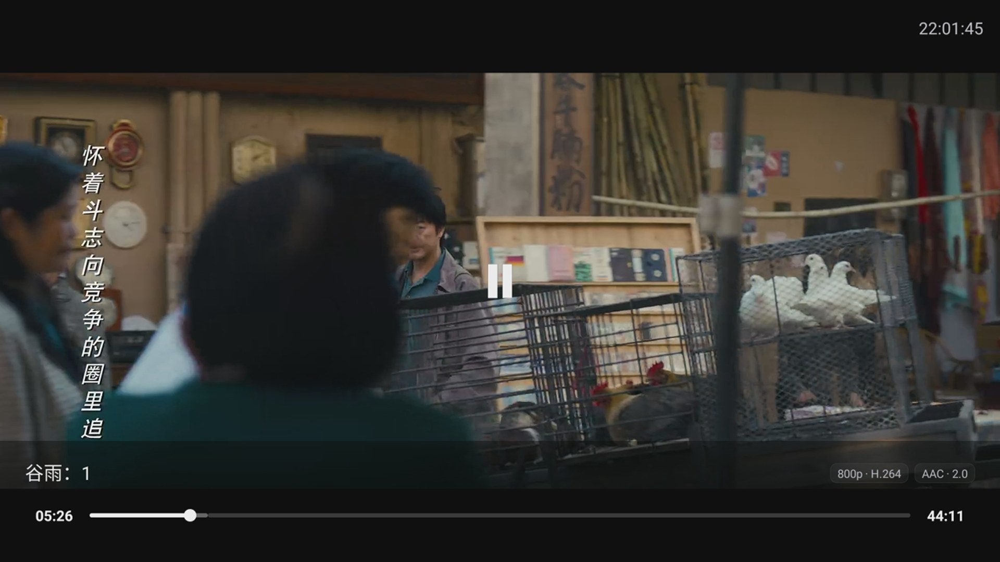
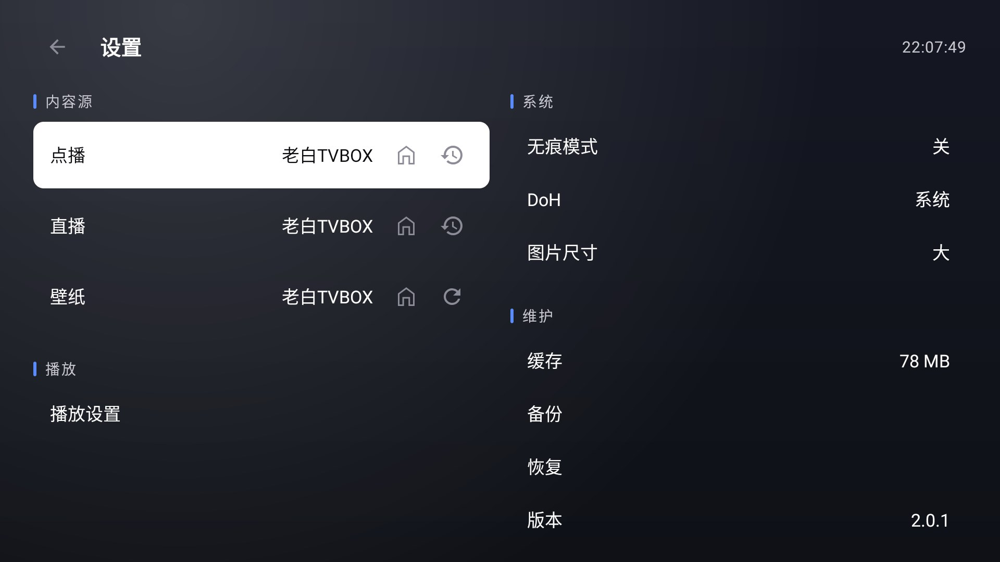
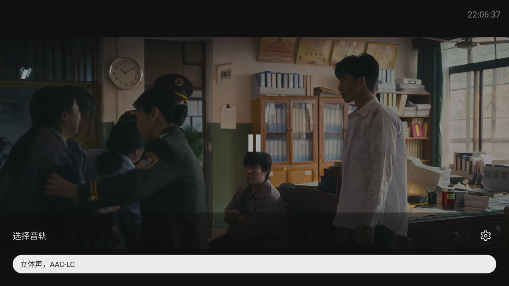

<p align="center">
  
</p>

<h1 align="center">QBox</h1>

**为 Android TV 和电视盒子打造的清爽播放器。** 无广告、无捆绑、不强制登录，导入你自己的 TVBox 兼容配置即可使用。

> A clean, ad-free video player for Android TV & TV boxes. Bring your own TVBox-compatible source.

> **重要说明**
>
> **QBox 只是一个播放器（壳），不提供、不内置、不附带任何影视内容、播放源或配置源。**
> 界面上的分类、海报、搜索结果和直播频道，全部来自你自己导入的配置源；
> 是否使用、如何使用，以及所使用内容是否合法，由你自行判断并承担全部责任。

## 项目性质

QBox 是 **FongMi/TV 的 UI / 交互重构版 TVBox 客户端**，面向 Android TV 与电视盒子。

- 本项目**不涉及视频源等信息**：不提供、不内置、不采集、不托管、不分发任何视频源、影视内容、直播源、账号或配置接口；
- 主要工作是基于个人使用习惯和审美，对 FongMi/TV 的界面布局、焦点逻辑、遥控器交互、播放控制与视觉样式做重构；
- 播放内核、媒体层和上游基础能力来自 FongMi/TV 与 FongMi/media，版权归其原作者所有；
- QBox 与 FongMi 官方没有隶属关系，也不是 FongMi 官方发行版。

<p align="center">
  
  
  
  
  
  
  
</p>

## 为什么用 QBox

- **干净**：没有开屏广告、没有弹窗、没有后台统计，也不需要注册账号。
- **好用**：遥控器优先设计，焦点清楚、层级简单，老人小孩也能上手。
- **自由**：内容源完全由你决定，随时更换，数据只保存在本机。
- **一直在更新**：内置检查更新，发现新版本一键下载安装。

## QBox 提供什么

QBox 只负责把配置源里的内容展示出来并播放，本身不生产、不存储、不分发任何内容。

**界面与交互**

- 海报墙、分类浏览、筛选、聚合搜索——展示的是你导入的配置源里的内容
- 遥控器优先设计：焦点清楚、层级简单，老人小孩也能上手
- 播放记录、收藏、断点续播，数据只保存在本机
- 沿用 QBox 立方体 Q 标识，启动器、设置页、首页头部、启动图和 Android TV 横幅使用同一套视觉

**播放器能力**

- 多音轨、字幕、倍速、片头片尾、循环播放
- 播放详情：分辨率、码率、帧率、解码方式一目了然
- 左右快进阶梯加速：轻按 10 秒，按住可加速到 5 分钟一步
- 解析你导入的 m3u / txt 直播源，分组选台
- 适配 720p / 1080p / 4K 电视，支持 32 位与 64 位设备

> 电影、剧集、综艺、动漫、短剧等分类，以及海报、简介、播放地址，全部由配置源提供，与 QBox 无关。
> 没有配置源时，QBox 只是一个空播放器。

## 下载

前往 **[GitHub Releases](https://github.com/zqs1qiwan/qbox/releases/latest)** 下载最新版本，或用固定链接（始终指向最新版）：

| 安装包 | 适用设备 |
|---|---|
| [QBox-latest-arm64-v8a.apk](https://github.com/zqs1qiwan/qbox/releases/latest/download/QBox-latest-arm64-v8a.apk) | 大多数 2019 年后的电视 / 盒子（64 位） |
| [QBox-latest-armeabi-v7a.apk](https://github.com/zqs1qiwan/qbox/releases/latest/download/QBox-latest-armeabi-v7a.apk) | 较老的 32 位电视 / 盒子 |

- 支持 Android 7.0 及以上
- 两个包使用相同签名，可以直接覆盖安装，数据不会丢失
- **签名已更换**：装过 1.9.12 或更早版本的用户，需要先卸载旧版再安装
  （配置、播放记录、收藏会清空）；1.9.13 及之后的版本签名一致，可直接覆盖
- 1.9.13 及之后的老客户端，启动弹窗或「设置 → 版本」检查更新，点「更新」即可升级到最新版
- 更早的安装包已从 Releases 移除，请只使用本页最新版本

## 安装

1. 下载与你设备架构匹配的 APK
2. 用 U 盘、电视文件管理器或手机传输工具安装（首次安装需允许「未知来源」）
3. 打开 QBox，点击左上角 **添加配置源**
4. 粘贴你的配置地址，确定，回到首页即可开始使用

## 配置源

QBox **不内置、不提供、不推荐任何影视内容或配置源**，需要你自己准备 TVBox 格式的配置。

- 配置源由第三方提供，QBox 不参与制作、不审核、不背书其中的内容
- 请只使用你有权访问的内容；使用第三方配置源产生的任何问题，由使用者自行承担
- 支持网络地址、本地文件等常见配置格式
- 设置页可以分别管理点播、直播、壁纸配置
- 配置里带有 `logo` 时，左上角显示配置的 logo；没有则显示 QBox 自己的 logo
- 首次打开是空白首页，点「添加配置源」即可导入，之后可在设置里随时更换

## 遥控器操作

| 场景 | 按键 |
|---|---|
| 首页 | 方向键选片，OK 进入；长按配置名可查看当前状态 |
| 播放 | OK 暂停 / 播放（可在设置里改为呼出菜单） |
| 播放 | 左右快进 / 快退；按住逐渐加速，最大 5 分钟一步 |
| 播放 | 上呼出进度条，左右微调，下返回 |
| 全局 | 返回键退出当前页面 |

## 自动更新

QBox 会检查 GitHub 最新版本：

- 启动时自动检查（有新版才弹窗）
- 设置 → 版本，可随时手动检查
- 弹窗里点「更新」即可下载并安装，无需手动找安装包
- 如果网络无法访问 GitHub，可以到 Releases 页面手动下载

## 隐私

- 不收集个人信息，不接入统计或广告 SDK
- 不需要账号，不会上传你的播放记录
- 配置、历史、收藏均保存在本机，卸载即清除

## 反馈

遇到问题或有建议，欢迎提交 [Issue](https://github.com/zqs1qiwan/qbox/issues)。

## 源码与上游

QBox 是 [FongMi/TV](https://github.com/FongMi/TV) 5.6.1 的二次开发，遵循 **GPL-3.0**。

- 本仓库 `zqs1qiwan/qbox` 是 QBox 的**唯一源码仓与发布仓**，`main` 是长期维护分支
- 当前版本：**2.0.1**（versionCode 101）
- TV 源码对齐 **FongMi/TV 5.6.1（`125468f0`，2026-08-27）**
- 媒体层来自 [FongMi/media](https://github.com/FongMi/media) 的 `release-1.11.0-fongmi` 分支，保持 media3 **1.11.0**，不升级
- 上游版本、改动范围与 Tier B 说明见 [`docs/UPSTREAM.md`](docs/UPSTREAM.md)
- 每个 Release 都附带对应版本的源码包 `QBox-<版本>-source.zip`
- 旧私有开发仓 `qbox-tv` 已归档为只读；后续开发、Issue、Release 都在本仓库进行

## 构建

1. JDK 21、Android SDK（compileSdk 37）、Gradle 9.7.1
2. 自编媒体 AAR：使用 FongMi/media 的 `release-1.11.0-fongmi` 分支，按 `move.txt` 生成 `lib-*-release.aar`，放进 `app/libs/`
3. 在仓库根目录创建 `local.properties`（**不要提交**）：

```properties
sdk.dir=/path/to/android-sdk
storeFile=/path/to/keystore.jks
keyAlias=your-alias
storePassword=******
keyPassword=******
```

4. 构建：

```bash
./gradlew :app:assembleLeanbackArmeabi_v7aRelease
./gradlew :app:assembleLeanbackArm64_v8aRelease
```

Windows 下可以用 `.toolchain/build.ps1 -Abi all -Variant Release`（脚本在仓库外，自动注入工具链环境变量）。

## 发布

1. 修改 `app/build.gradle` 的 `versionCode` / `versionName`
2. 更新 `docs/RELEASE-NOTES-<版本>.md`
3. 构建两个 ABI 的 release APK，并用正式签名验证证书指纹
4. `git archive` 导出源码包 `QBox-<版本>-source.zip`
5. 提交并打 `v<版本>` tag，CI 自动创建 GitHub Release
6. 资产命名：`QBox-<版本>-arm64-v8a.apk`、`QBox-<版本>-armeabi-v7a.apk`、`QBox-<版本>-source.zip`；`QBox-latest-*.apk` 是固定下载链接的副本

## 约束

- **release 包不包含任何内容源**：`QBOX_TEST_CONFIG` 只在 debug 构建注入，`qbox_default.json` 只放在 `src/debug/assets`
- 不接入统计、广告或账号 SDK
- 提交前确认没有把 `local.properties`、`*.jks`、`build/`、`Release/` 带进仓库

## 致谢与许可

QBox 基于 [FongMi/TV](https://github.com/FongMi/TV) 二次开发，遵循 **GPL-3.0**。
播放能力来自 AndroidX Media3 / ExoPlayer 与 MPV。

QBox 仅作为播放器工具，不提供、不存储、不分发任何影视资源。
所有内容均来自用户自行导入的第三方配置源，与 QBox 项目无关。
请遵守你所在地区的法律法规，支持正版内容。
