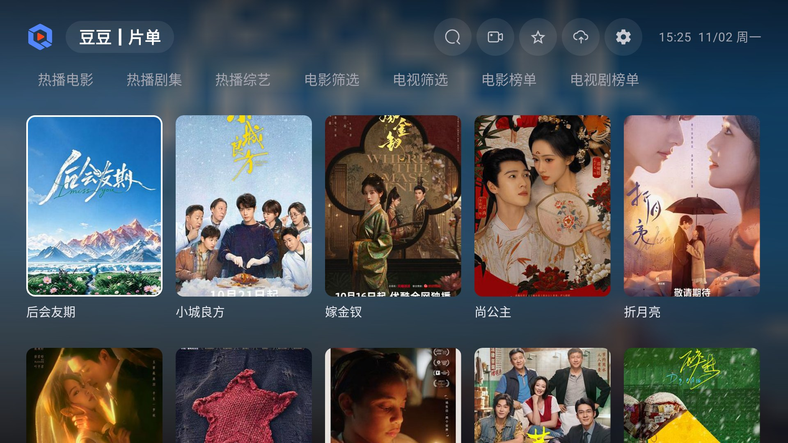
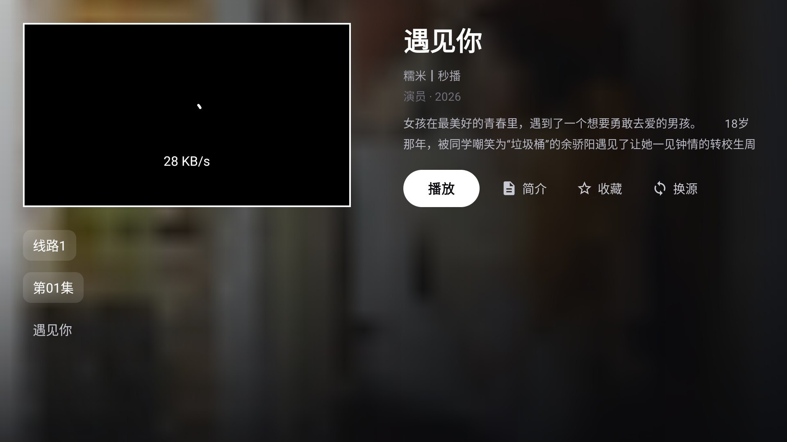

# QBox

**为 Android TV 和电视盒子打造的清爽播放器。** 无广告、无捆绑、不强制登录，导入你自己的配置源即可使用。

> A clean, ad-free video player for Android TV & TV boxes. Bring your own TVBox-compatible source.

> **重要说明**
>
> **QBox 只是一个播放器（壳），不提供、不内置、不附带任何影视内容、播放源或配置源。**
> 界面上的分类、海报、搜索结果和直播频道，全部来自你自己导入的配置源；
> 是否使用、如何使用，以及所使用内容是否合法，由你自行判断并承担全部责任。

  
  

## 为什么用 QBox

- **干净**：没有开屏广告、没有弹窗、没有后台统计，也不需要注册账号。
- **好用**：遥控器优先设计，焦点清楚、层级简单，老人小孩也能上手。
- **自由**：内容源完全由你决定，随时更换，数据只保存在本机。
- **一直在更新**：内置检查更新，发现新版本一键下载安装。

## QBox 提供什么

QBox 只负责把配置源里的内容展示出来并播放，本身不生产、不存储、不分发任何内容。

**界面与交互**

- 海报墙、分类浏览、筛选、聚合搜索——展示的是你导入的配置源里的内容
- 遥控器优先设计：焦点清楚、层级简单，老人小孩也能上手
- 播放记录、收藏、断点续播，数据只保存在本机

**播放器能力**

- 多音轨、字幕、倍速、片头片尾、循环播放
- 播放详情：分辨率、码率、帧率、解码方式一目了然
- 左右快进阶梯加速：轻按 10 秒，按住可加速到 5 分钟一步
- 解析你导入的 m3u / txt 直播源，分组选台
- 适配 720p / 1080p / 4K 电视，支持 32 位与 64 位设备

> 电影、剧集、综艺、动漫、短剧等分类，以及海报、简介、播放地址，全部由配置源提供，与 QBox 无关。
> 没有配置源时，QBox 只是一个空播放器。

## 下载

前往 **[GitHub Releases](https://github.com/zqs1qiwan/qbox/releases/latest)** 下载最新版本：

| 安装包 | 适用设备 |
|---|---|
| `QBox-*-arm64-v8a.apk` | 大多数 2019 年后的电视 / 盒子 |
| `QBox-*-armeabi-v7a.apk` | 较老的 32 位电视 / 盒子 |

- 支持 Android 7.0 及以上
- 两个包使用相同签名，可以直接覆盖安装，数据不会丢失
- **1.9.13 起使用新的签名密钥**：如果你装过 1.9.12 或更早的版本，
  需要先卸载旧版再安装（配置、播放记录、收藏会清空）
- 更早的安装包已从 Releases 移除，请只使用本页最新版本

## 源码

QBox 基于 FongMi/TV 二次开发，遵循 GPL-3.0。

- 每个 Release 都附带对应版本的源码包 `QBox-<版本>-source.zip`
- 源码包内含构建说明；media 相关 AAR 由公开的 [FongMi/media](https://github.com/FongMi/media) 分支构建
- 本仓库只用于发布安装包与源码包

## 安装

1. 下载与你设备架构匹配的 APK
2. 用 U 盘、电视文件管理器或手机传输工具安装（首次安装需允许「未知来源」）
3. 打开 QBox，点击左上角 **添加配置源**
4. 粘贴你的配置地址，确定，回到首页即可开始使用

## 配置源

QBox **不内置、不提供、不推荐任何影视内容或配置源**，需要你自己准备 TVBox 格式的配置。

- 配置源由第三方提供，QBox 不参与制作、不审核、不背书其中的内容
- 请只使用你有权访问的内容；使用第三方配置源产生的任何问题，由使用者自行承担
- 支持网络地址、本地文件等常见配置格式
- 设置页可以分别管理点播、直播、壁纸配置
- 配置里带有 `logo` 时，左上角显示配置的 logo；没有则显示 QBox 自己的 logo
- 首次打开是空白首页，点「添加配置源」即可导入，之后可在设置里随时更换

## 遥控器操作

| 场景 | 按键 |
|---|---|
| 首页 | 方向键选片，OK 进入；长按配置名可查看当前状态 |
| 播放 | OK 暂停 / 播放（可在设置里改为呼出菜单） |
| 播放 | 左右快进 / 快退；按住逐渐加速，最大 5 分钟一步 |
| 播放 | 上呼出进度条，左右微调，下返回 |
| 全局 | 返回键退出当前页面 |

## 自动更新

QBox 会检查 GitHub 最新版本：

- 启动时自动检查（有新版才弹窗）
- 设置 → 版本，可随时手动检查
- 弹窗里点「更新」即可下载并安装，无需手动找安装包
- 如果网络无法访问 GitHub，可以到 Releases 页面手动下载

## 常见问题

**安装时提示「应用未安装」？**
确认安装包架构与设备匹配；删除旧版残留或清理存储空间后重试。仍不行可用 U 盘重新拷贝安装。

**能播放但很卡？**
在播放页按「更多」切换硬解 / 软解，或返回详情页换一条线路、换一个内容源。

**只有声音没有画面？**
切换解码方式或视轨；部分片源与设备解码器不兼容，换源通常可以解决。

**语音搜索用不了？**
部分电视盒子没有内置语音识别服务，可以用遥控器直接输入；QBox 会给出提示。

**检查更新失败？**
说明当前网络无法访问 GitHub。到 [Releases](https://github.com/zqs1qiwan/qbox/releases/latest) 手动下载即可。

## 隐私

- 不收集个人信息，不接入统计或广告 SDK
- 不需要账号，不会上传你的播放记录
- 配置、历史、收藏均保存在本机，卸载即清除

## 反馈

遇到问题或有建议，欢迎提交 [Issue](https://github.com/zqs1qiwan/qbox/issues)。

## 致谢与许可

QBox 基于 [FongMi/TV](https://github.com/FongMi/TV) 二次开发，遵循 **GPL-3.0** 许可证。
播放能力来自 AndroidX Media3 / ExoPlayer 与 MPV。

QBox 仅作为播放器工具，不提供、不存储、不分发任何影视资源。
所有内容均来自用户自行导入的第三方配置源，与 QBox 项目无关。
请遵守你所在地区的法律法规，支持正版内容。
